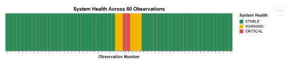
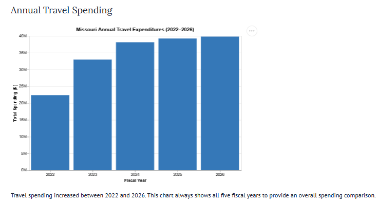

# Continuous Intelligence System Assessment

Continuous Intelligence | Project 06 | Custom Project

**Author:** Angie Crews
**Date:** November 2026

## Overview

This project combines signal design, anomaly detection, and system assessment into a continuous intelligence pipeline.

The objective is to evaluate system performance using both overall averages and individual observations.

The project expands the original two-level assessment into three health classifications:

- 🟢 **STABLE** - No thresholds exceeded.
- 🟡 **WARNING** - One threshold exceeded.
- 🔴 **CRITICAL** - Two thresholds exceeded.

An interactive Marimo application allows users to adjust thresholds and observe how system classifications change.

## Data

The dataset contains 60 observations of system activity.

Each observation records:

- Requests handled.
- Errors encountered.
- Total response time in milliseconds.

The dataset includes a period of elevated errors and response times.

[View System Metrics Dataset](https://github.com/Angie-Crews/cintel-06-continuous-intelligence/blob/main/data/system_metrics.csv)

## Methods

The pipeline uses Polars to process system metrics and evaluate system health.

### 1. Signal Design

Raw measurements are transformed into:

- **Error rate:** Errors divided by requests.
- **Average latency:** Total latency divided by requests.
- **Throughput:** A calculated monitoring signal.

### 2. Anomaly Detection

Individual observations are flagged when:

- Error rate exceeds 5%, or
- Average latency exceeds 40 milliseconds.

### 3. Three-Level System Assessment

The customized project evaluates how many thresholds each observation exceeds.

| Classification | Thresholds Exceeded | Interpretation |
|---|---:|---|
| 🟢 STABLE | 0 | Normal conditions |
| 🟡 WARNING | 1 | Potential performance concern |
| 🔴 CRITICAL | 2 | Multiple performance concerns |

The pipeline also calculates average measurements across all observations to determine the overall system state.

### 4. Interactive Monitoring

The Marimo application includes adjustable thresholds, observation classifications, and an interactive Altair chart.

Changing either threshold automatically updates the system health summary, chart, and anomaly results.

## Results

The pipeline successfully processed 60 observations.

### Observation Health Summary

| Classification | Observations | Percentage |
|---|---:|---:|
| 🟢 STABLE | 53 | 88.3% |
| 🟡 WARNING | 5 | 8.3% |
| 🔴 CRITICAL | 2 | 3.3% |
| **Total** | **60** | **100%** |

Seven observations exceeded at least one threshold.

### Overall System Assessment

| Metric | Result |
|---|---:|
| Average requests | 157.35 |
| Average errors | 4.03 |
| Average error rate | 2.65% |
| Average latency | 33.71 ms |
| Thresholds exceeded | 0 |
| Overall system state | STABLE |

[View Overall System Assessment](https://github.com/Angie-Crews/cintel-06-continuous-intelligence/blob/main/artifacts/system_assessment.csv)

[View Individual Observation Assessments](https://github.com/Angie-Crews/cintel-06-continuous-intelligence/blob/main/artifacts/observation_assessments.csv)

### Interactive Visualization



The Marimo application displays a color-coded chart of all 60 observations.

- Green represents STABLE observations.
- Yellow represents WARNING observations.
- Red represents CRITICAL observations.

The chart responds to changes in the error rate and latency sliders.

[Open the Reactive App](./app/index.html)

## Interpretation

The overall system assessment was **STABLE** because the average error rate and latency remained below the configured thresholds.

However, the observation-level analysis identified:

- 53 stable observations.
- 5 warning observations.
- 2 critical observations.

This demonstrates that overall averages can hide shorter periods of performance problems.

Evaluating individual observations provides a clearer understanding of when system performance may require attention.

## Technical Modification and Experiment

The original project classified system health as STABLE or DEGRADED.

The customized version introduces three classifications and evaluates each observation individually.

The experiment was designed to determine whether additional classifications would provide more useful information about system performance.

The results showed that the overall system remained STABLE, while seven individual observations exceeded thresholds.

The modification provided additional information by distinguishing observations with one threshold violation from those with two.

## Limitations

The analysis uses a fixed dataset of 60 observations and manually selected thresholds.

The classifications indicate threshold violations but do not establish the actual severity or cause of a performance issue.

Although individual observations are now saved for further analysis, the project does not yet include:

- Rolling-window monitoring.
- Reference-period drift comparisons.
- Automated notifications.
- Continuous real-time data collection.

Future improvements could incorporate these techniques to provide more complete monitoring.

## Conclusion

This project demonstrates how continuous intelligence combines monitoring signals, anomaly detection, and system classification.

The most important finding is that **an overall STABLE assessment does not mean every individual observation is within acceptable limits**.

The three-level classification system and interactive visualization provide additional detail for identifying and investigating potential performance problems.

## Part D3: Missouri State Travel Expenditure Dashboard

### Custom Project Overview

For Part D3, I developed a custom dashboard to analyze Missouri state travel expenditures for fiscal years 2022–2026.

The goal was to identify spending trends, compare state agencies, examine travel expense categories, and flag unusually large payments for further review.

Unlike the original system monitoring example, this application uses actual state expenditure records to explore financial activity.

### Data Source

The project uses Missouri State Expenditures data from the [Missouri Open Data Portal](https://data.mo.gov/).

Five annual CSV files were combined into one dataset containing **178,028 travel expenditure records**.

| Fiscal Year | Travel Records |
|---|---:|
| 2022 | 26,629 |
| 2023 | 36,560 |
| 2024 | 38,691 |
| 2025 | 38,746 |
| 2026 | 37,402 |
| **Total** | **178,028** |

The dataset includes fiscal year, state agency, expense category, expense description, vendor, and payment amount.

### Methods and Tools

I used Python and Polars to prepare and analyze the expenditure data.

The process included:

1. Loading five annual expenditure files.
2. Filtering records to the TRAVEL category.
3. Validating payment amounts and combining the annual files.
4. Calculating total spending by fiscal year, state agency, and expense type.
5. Creating interactive Altair charts in a Marimo application.
6. Adding a fiscal-year dropdown to compare spending across different periods.
7. Adding an adjustable dollar threshold to flag unusually large payments.

### Results and Visualizations

#### Annual Travel Spending

| Fiscal Year | Approximate Spending |
|---|---:|
| 2022 | $22.33 million |
| 2023 | $32.95 million |
| 2024 | $38.11 million |
| 2025 | $39.23 million |
| 2026 | $39.81 million |

Travel spending increased from approximately $22.33 million in 2022 to $39.81 million in 2026.

The dashboard includes charts comparing annual spending, state agencies, and travel expense categories.



#### Spending by Agency

The Judiciary, Social Services, and Health and Senior Services were among the agencies with the highest total travel spending across the five years.

The interactive fiscal-year selector allows users to examine agency spending for individual years or all years combined.

#### Spending by Expense Type

In-state lodging and in-state mileage were the largest travel expense categories by total spending.

The charts demonstrate why examining both the number of records and the dollar amounts is useful. A category with fewer records may still account for substantial spending.

#### Unusual Travel Payments

The application includes an adjustable threshold for identifying large payments.

During testing, a threshold of **$26,000** produced:

| Measure | Result |
|---|---:|
| Flagged payments | 514 |
| Combined flagged value | $67,419,966.95 |
| Period analyzed | 2022–2026 |

Several of the largest flagged payments were classified as in-state lodging, with the vendor listed as Procurement Card Payment.

These payments may represent combined or aggregated transactions. A large payment alone does not establish that an expense is incorrect or improper.

### Interpretation

The most important finding is that Missouri travel spending increased across the five-year period, while spending was concentrated in certain agencies and expense categories.

The unusual-payment analysis also demonstrated how adjustable thresholds can help identify transactions that may deserve additional investigation.

Using interactive charts made it easier to compare financial activity across years and understand where spending was concentrated.

### Limitations

The analysis uses historical expenditure records rather than real-time transactions.

The dataset does not provide enough supporting information to determine whether a flagged payment is inappropriate. Some payments may represent multiple transactions or consolidated charges.

The threshold is a screening tool rather than a statistically validated anomaly-detection method.

The analysis also does not adjust spending for inflation, changes in agency operations, or differences in reporting practices.

### Next Steps

If I continued this project, I would examine spending changes within individual agencies, investigate unusually large payments using supporting transaction details, and develop more specific thresholds for different expense categories.

I would also explore rolling averages and drift detection to identify changes in travel spending patterns over time.

### Custom Application

The custom application is located in:

`src/cintel/missouri_travel_app.py`

Run the application with:

```powershell
uv run marimo run src/cintel/missouri_travel_app.py
```

The dashboard includes interactive spending charts, a fiscal-year selector, and unusual-payment analysis.

[View Custom Application Source](https://github.com/Angie-Crews/cintel-06-continuous-intelligence/blob/main/src/cintel/missouri_travel_app.py)

## Documentation Index

- **Home** - This landing page.
- [Project Instructions](project-instructions.md)
- [Glossary](glossary.md)
- [API](api.md)
- [Reactive App](./app/index.html)

## Project Links

- [GitHub Repository](https://github.com/Angie-Crews/cintel-06-continuous-intelligence)
- [Python Monitoring Pipeline](https://github.com/Angie-Crews/cintel-06-continuous-intelligence/blob/main/src/cintel/continuous_intelligence.py)
- [Marimo Application](https://github.com/Angie-Crews/cintel-06-continuous-intelligence/blob/main/src/cintel/app.py)
- [Results and Artifacts](https://github.com/Angie-Crews/cintel-06-continuous-intelligence/tree/main/artifacts)

## Project Resources

- [Project Instructions](project-instructions.md)
- [Professional Python Guide](https://denisecase.github.io/pro-analytics-02/)
- [Professional Python Project Explainer](https://pup-pack.github.io/professional-python-project-explainer/)
- [Suggested Datasets](https://denisecase.github.io/pro-analytics-02/reference/datasets/cintel/)
